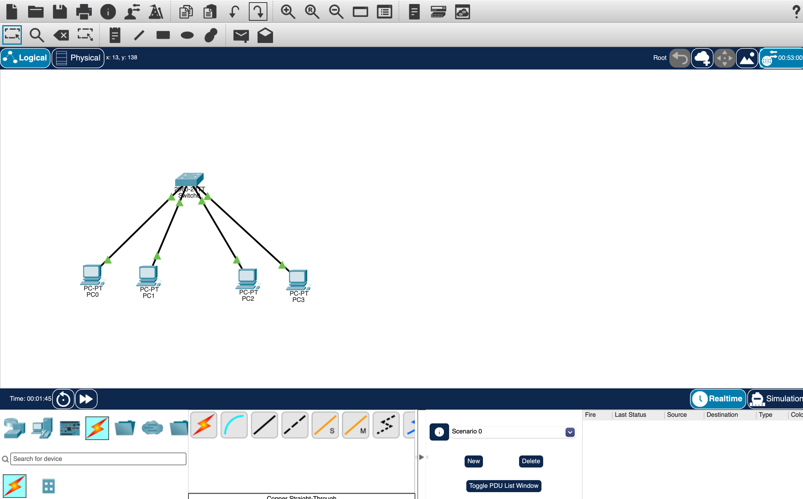

# Cisco VLAN Network Lab

## Project Overview

This project demonstrates the configuration and testing of Virtual Local Area Networks (VLANs) using Cisco Packet Tracer.

I designed a small enterprise network that separates the IT and Engineering departments into two VLANs using a Cisco 2960 switch.

The objective was to configure network segmentation, establish connectivity within each VLAN, and verify isolation between departments.

## Technologies Used

- Cisco Packet Tracer
- Cisco Catalyst 2960 Switch
- Cisco IOS Command Line Interface (CLI)
- VLAN Configuration
- Ethernet Switching
- IPv4 Addressing
- ICMP Connectivity Testing

## Network Topology

The network consists of one Cisco switch and four computers.

| Device | Switch Port | VLAN | IP Address |
|---|---|---|---|
| PC0 | Fa0/1 | 10 (IT) | 192.168.10.10 |
| PC1 | Fa0/2 | 10 (IT) | 192.168.10.11 |
| PC2 | Fa0/3 | 20 (Engineering) | 192.168.20.10 |
| PC3 | Fa0/4 | 20 (Engineering) | 192.168.20.11 |

Subnet mask: `255.255.255.0`

## VLAN Configuration

Created two VLANs on the Cisco switch:

- VLAN 10 — IT Department
- VLAN 20 — Engineering Department

### Cisco Switch Commands

```text
enable
configure terminal

vlan 10
name IT
exit

vlan 20
name Engineering
exit

interface range fa0/1 - 2
switchport mode access
switchport access vlan 10
exit

interface range fa0/3 - 4
switchport mode access
switchport access vlan 20
exit

end
show vlan brief
```

## Network Testing

I performed connectivity tests to verify the VLAN configuration.

| Test | Expected Result | Actual Result |
|---|---|---|
| PC0 → PC1 | Successful | Passed |
| PC2 → PC3 | Successful | Passed |
| PC0 → PC2 | No connectivity | Passed |

The tests confirmed that devices within the same VLAN could communicate successfully.

Devices in different VLANs could not communicate because inter-VLAN routing was not configured.

## Skills Demonstrated

- Configuring Cisco switches using IOS CLI
- Creating and naming VLANs
- Assigning switch ports to VLANs
- Configuring static IPv4 addresses
- Troubleshooting network connectivity
- Using ping to verify communication
- Verifying VLAN configuration
- Understanding Layer 2 network segmentation

## Project Files

`Cisco-VLAN-Network-Lab.pkt` — Cisco Packet Tracer project containing the network topology and configuration.

## Conclusion

This lab provided hands-on experience with Cisco VLAN configuration and network segmentation.

It demonstrates foundational networking skills applicable to enterprise networks, data center environments, and CCNA-level networking.
